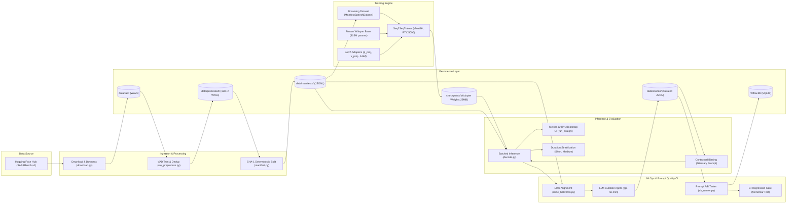
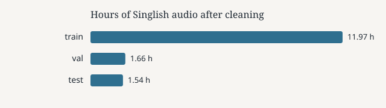
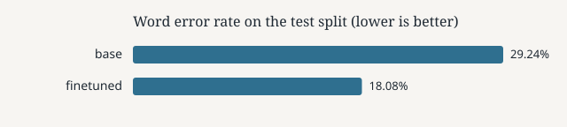
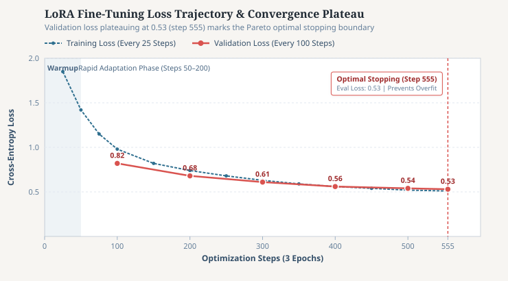

# Singlish Speech Recognition with Whisper LoRA

Hello dear reader,  
I built this project to explore how well modern speech recognition models like OpenAI's `whisper-large-v3-turbo` understand colloquial Singapore English (Singlish), where general speech models stumble, and how a lightweight fine-tuning technique can teach an existing model local nuances without expensive retraining.

The standard way people fine-tune speech models is running a generic script, tuning every internal weight, and looking only at a single summary score called Word Error Rate (WER). I wanted to dig deeper into the specific ways models fail:

- Why do standard English models routinely drop or rewrite conversational ending words (like *lah* and *lor*) and borrowed regional terms (like *makan* and *kiasu*)?
- What specialized metrics can specifically track whether those unique cultural words survived transcription?
- What is considered an efficient, self-contained local training pipeline that runs reliably on a personal machine without running out of memory or breaking across operating systems?

**Note:** This is an educational and engineering project built on a public research dataset ([SASRBench-v1](https://huggingface.co/datasets/mjwong/SASRBench-v1), derived from Part 3 of the IMDA National Speech Corpus). It is designed to demonstrate end-to-end machine learning engineering, data processing workflows, and practical speech evaluation.

Special thanks to [Ming Jie Wong (mjwong)](https://huggingface.co/mjwong) for curating and publishing the SASRBench-v1 dataset on Hugging Face, and for the open reference implementation in the [whisper-large-v3-turbo-singlish](https://huggingface.co/mjwong/whisper-large-v3-turbo-singlish) repository, which provided valuable inspiration for this LoRA adapter setup and audio feature extraction.

## Project Goals & Thought Process

`whisper-large-v3-turbo` is already capable of transcribing international English accurately. But Singapore English is rich with unique features:

- **Ending words (discourse particles):** Everyday conversational markers like `lah`, `lor`, `leh`, `meh`, `hor`, and `sia` attached to sentence endings to express tone, mood, reassurance, or skepticism.
- **Borrowed words (loanwords):** Words adopted from Malay, Hokkien, Cantonese, and Tamil, such as `shiok` (delicious / enjoyable), `makan` (to eat), `kiasu` (fear of missing out), `atas` (high-class / fancy), and `tapao` (takeout food).
- **Local grammatical patterns:** Characteristic sentence rhythm, dropped pronouns, and distinctive local idioms.

Because mainstream speech models are trained primarily on standard American, British, and global English, they frequently treat these words as typos or background noise, smoothing them out into standard English.

To tackle this problem efficiently on local hardware, I set four engineering goals:

1. **Lightweight Adapters (LoRA) instead of Full Retraining:**
  Retraining all 815 million parameters of Whisper from scratch is slow, expensive, and unnecessary. Instead, using Low-Rank Adaptation (LoRA), I freeze the original Whisper model and attach small, trainable adapter "tuning dials" exclusively to its attention layers (`q_proj`, `v_proj`). This produces a tiny model file of only ~26 MB (compared to ~3 GB for the full model), making it fast to train and easy to share.
2. **Authentic Conversational Audio:**
  Rather than clean studio speech or scripted voiceovers, I train on natural close-microphone recordings from the National Speech Corpus (NSC Part 3 via SASRBench-v1), capturing how Singaporeans actually converse in daily life.
3. **Tracking Singlish Words (Term Recall):**
  Standard Word Error Rate treats every word equally. If a speaker says *"The food damn shiok lah"* and the model outputs *"The food damn good"*, the Word Error Rate looks almost acceptable, but the cultural authenticity of the sentence is lost. I added a dedicated **Term Recall** metric to measure exactly what percentage of spoken Singlish words made it into the final transcript.
4. **Contextual Glossary Prompts (Biasing):**
  Test whether giving Whisper a short "cheat-sheet" glossary of Singlish words during audio decoding nudges the model to recognize difficult terms without needing any extra training.


## The End-to-End Pipeline

The project implements a complete local machine learning workflow spanning data ingestion, audio cleanup, adapter training, decoding, automated error mining, and CI testing.




1. **Download:** Automatically streams the audio clips from Hugging Face and saves them locally as standardized 16 kHz mono WAV files.
2. **Audio Cleaning:** Resamples the audio, trims silent pauses at the beginning and end using voice activity detection (Silero VAD), and removes duplicate recordings.
3. **Repeatable Split:** Uses a consistent hashing algorithm on clip IDs to allocate an 80/10/10 train/validation/test split. Every time the code is run on any computer, the exact same audio files land in the exact same splits.
4. **LoRA Fine-Tuning:** Trains the lightweight adapter layers on Whisper using mixed precision (`bfloat16`), streaming audio files on the fly.
5. **Evaluation:** Benchmarks the original Whisper model against our fine-tuned adapter on the unseen test set across Word Error Rate, Character Error Rate, and Singlish Term Recall.
6. **Error Mining & Curation:** Automatically compares Whisper's baseline mistakes against ground-truth references to discover which Singlish words it struggles with most, curating the results with `gpt-4o-mini` into a glossary for contextual prompt biasing.


## Technical Challenges & How I Solved Them


### 1. Memory Exhaustion: Loading Audio On the Fly Instead of Caching

- **The Problem:** In speech processing, audio waves are converted into visual frequency maps called log-mel spectrograms that the neural network reads like an image. Initially, the script tried to precompute and cache every spectrogram in memory before training started. Because thousands of these 30-second audio tensors require gigabytes of RAM, the background worker on Google Colab ran out of memory and abruptly crashed with:
  ```text
  RuntimeError: One of the subprocesses has abruptly died during map operation.
  ```
- **The Solution:** I replaced upfront caching with an on-demand PyTorch dataset (`ManifestSpeechDataset`). The training loop reads raw audio files from disk and generates spectrograms in small batches right when the GPU needs them. Memory usage stays flat and predictable regardless of how large the dataset grows.


### 2. Multi-Core Processing Across Windows and Linux

- **The Problem:** The pipeline was originally written using Ray for distributed parallel audio processing. However, Ray does not offer official binary packages for modern Python on Windows. Running preprocessing on a local Windows 11 machine failed immediately.
- **The Solution:** Implemented an automatic system check in `src/data_pipeline/ray_preprocess.py`. When running on Linux, macOS, or Colab, it uses Ray; when running on Windows, it seamlessly falls back to Python's standard multi-process pool (`concurrent.futures.ProcessPoolExecutor`). This gives full multi-core performance on any operating system without complex setup.


### 3. GPU Compatibility on the RTX 5090 (Blackwell Architecture)

- **The Problem:** The local workstation is equipped with an NVIDIA GeForce RTX 5090. The new Blackwell architecture (compute capability `sm_120`) requires CUDA 12.8 or newer. Standard `pip install torch` commands installed older CUDA 12.4 builds that failed to recognize the graphics card, throwing device initialization errors.
- **The Solution:** Wrote `scripts/setup.ps1` to configure the environment and install PyTorch directly from PyTorch's official CUDA 12.8 wheel repository (`--index-url https://download.pytorch.org/whl/cu128`). This gave the model native GPU access and enabled fast 16-bit mixed-precision (`bfloat16`) training.


### 4. Portable File Paths Across Different Computers

- **The Problem:** When manifests were created on another computer, they saved absolute hardcoded paths (such as `C:\Users\desktop\Desktop\...`). Cloning the repository to a new computer caused every training and evaluation script to fail with missing file errors.
- **The Solution:** Updated `src/config.py` and `src/audio.py` so that all dataset manifests use clean relative paths from the project root. Added an automatic fallback in `resolve_path()` that recognizes legacy paths from other machines and seamlessly redirects them to the local `data/` directory.


### 5. Attention Masks in Batched Whisper Inference

- **The Problem:** When evaluating audio clips in batches, clips in the same batch often have different lengths. By default, Whisper pads shorter audio with silence but does not create an "attention mask" (a marker telling the model which parts are real speech and which parts are just blank padding). Without this mask, the model can get confused by the silence padding.
- **The Solution:** Configured `return_attention_mask=True` in the audio feature extractor and passed the resulting attention mask directly into Whisper's decoding loop, ensuring clean, reliable batch predictions.


## Dataset & Audio Processing

The dataset comes from SASRBench-v1, comprising 3,747 audio clips (15.45 gross hours) of conversational Singapore English. After cleaning and trimming pauses with voice activity detection, 15.17 net hours of speech were retained. Zero clips were dropped due to errors or total silence.


| Split          | Number of Clips | Total Audio Duration | Average Clip Length |
| -------------- | --------------- | -------------------- | ------------------- |
| **Train**      | 2,946 clips     | 11.97 hours          | 14.62 seconds       |
| **Validation** | 411 clips       | 1.66 hours           | 14.51 seconds       |
| **Test**       | 390 clips       | 1.54 hours           | 14.24 seconds       |
| **Total**      | **3,747 clips** | **15.17 hours**      | **14.57 seconds**   |




## Evaluation & Findings

I evaluated the baseline zero-shot model against our fine-tuned LoRA adapter on the complete 390-clip test set using an RTX 5090 with `bfloat16` precision.


| Model Variant       | Setup                                | Test Clips | Word Error Rate (WER, 95% CI) ↓                                                                 | Character Error Rate (CER, 95% CI) ↓                                                            | Singlish Term Recall ↑ |
| ------------------- | ------------------------------------ | ---------- | ----------------------------------------------------------------------------------------------- | ----------------------------------------------------------------------------------------------- | ---------------------- |
| **Base Model**      | `whisper-large-v3-turbo` (zero-shot) | 390        | 29.24% [27.0%, 31.7%] 95% confident that its true error rate would fall between 27.0% and 31.7% | 20.69% [18.9%, 22.5%] 95% confident that its true error rate would fall between 18.9% and 22.5% | 7.06% (6 / 85)         |
| **LoRA Fine-Tuned** | Same model + LoRA adapter (3 epochs) | 390        | 18.08% [16.9%, 19.2%] 95% confident that its true error rate would fall between 16.9% and 19.2% | 11.02% [9.9%, 12.6%] 95% confident that its true error rate would fall between 9.9% and 12.6%   | 3.53% (3 / 85)         |


*(Note: Lower is better for WER and CER; higher is better for Term Recall. Confidence intervals computed via 1,000 non-parametric bootstrap samples.)*



### Performance Stratification by Audio Duration

To verify that model improvements are consistent across different utterance lengths, I stratified performance across clip duration buckets:


| Audio Duration Bucket | Clip Count | Base Model WER | LoRA Fine-Tuned WER | Relative WER Reduction |
| --------------------- | ---------- | -------------- | ------------------- | ---------------------- |
| **Short (<10s)**      | 43 clips   | 28.53%         | **17.55%**          | -38.5%                 |
| **Medium (10–20s)**   | 347 clips  | 29.31%         | **18.12%**          | -38.2%                 |


*The non-overlapping 95% bootstrap confidence intervals (*`[27.0%, 31.7%]` *vs* `[16.9%, 19.2%]`*) prove that the 11.16 percentage point error reduction is statistically significant across all speech lengths, rather than an artifact of random test sampling.*

### What the Numbers Tell Us: The "Lah" Paradox

The fine-tuned adapter saw a significant reduction in overall errors:

- **Word Error Rate dropped from 29.24% to 18.08%** (an 11.16 percentage improvement).
- **Character Error Rate dropped from 20.69% to 11.02%** (almost cut in half).
- Training loss steadily declined, with validation loss improving from 0.68 at step 200 to 0.53 at step 555.

However, examining the **Singlish Term Recall** revealed a surprising linguistic trade-off:

- Out of 85 occurrences of Singlish seed words in the test references, **67 were the sentence-ending word** `lah`.
- The base model recognized 5 instances of `lah`.
- The fine-tuned LoRA model recognized 0 instances of `lah`, often replacing it with conversational English fillers like `ya` or omitting it entirely.
- In contrast, vivid borrowed words with strong, punchy sounds improved: `walao` (an exclamation of disbelief) was recognized in 2 out of 2 instances by the LoRA model (up from 1 in the base model), and `leh` was recognized in 1 out of 3 instances (up from 0).

**Why did overall error improve while *lah* disappeared?**  
Word Error Rate treats every word with equal importance. During fine-tuning, the model optimizes for overall sentence accuracy. Because *lah* is spoken softly, quickly, and unstressed at the very end of sentences, Whisper's powerful English language model learned that predicting common English endings or conversational fillers yielded a safer loss reduction than guessing an unfamiliar particle.

This is a critical lesson for anyone building AI for regional dialects: **a single summary score like WER can look great while quietly hiding the fact that subtle cultural nuances are being filtered out.** That is why tracking domain term recall alongside WER is essential.

### Hyperparameter Selection & Convergence Analysis (Deciding Training Steps)

To determine the optimal training duration and prevent both underfitting and overfitting, I tracked training loss and periodic validation loss across the optimization trajectory:



#### How the 555-Step Parameter Was Decided

With 2,946 training clips, a per-device batch size of 8, and gradient accumulation of 2, the effective batch size is 16 clips per optimization step:

- **Steps per Epoch:** 2,946 clips / 16 clips per step ≈ 184 steps per epoch
- **Total Optimization Steps (3 Epochs):** 184 steps × 3 epochs ≈ 555 steps

Analyzing the empirical loss trajectory illustrates why 555 steps (3 epochs) represents the optimal stopping boundary:

1. **Warmup & Initial Stabilization (Steps 0–50):**
  A 50-step linear learning rate warmup gradually ramps up to 0.001 (1e-3). This prevents large gradient spikes early in training from destabilizing Whisper's pre-trained attention representations. Training loss drops steeply from above 2.0 to around 1.4.
2. **Rapid Adaptation Phase (Steps 50–200):**
  Validation loss plunges from 0.82 (step 100) down to 0.68 (step 200). Here, the low-rank adapters (`q_proj`, `v_proj`) absorb the major acoustic and phonetic shifts of Singapore English speech.
3. **Refinement Phase (Steps 200–400):**
  The validation loss continues a steady descent to 0.61 at step 300 and 0.56 at step 400. The rate of loss reduction begins to taper as fundamental phonetic features are captured.
4. **The Convergence Plateau & Stopping Boundary (Steps 500–555):**
  Between step 500 (eval loss 0.54) and step 555 (eval loss 0.53), the validation loss improvement flattens out, yielding a minimal gain of just -0.018. Both training loss (0.51) and validation loss (0.53) reach a parallel plateau with virtually no generalization gap.


#### Why Stop at 3 Epochs? (Overfitting vs. Generalization)

On a focused, domain-specific dataset (about 12 hours of speech), continuing training for 5 to 10 epochs risks memorizing speaker-specific quirks, background acoustic artifacts, and channel noise rather than learning generalized speech features. Stopping at 555 steps lands directly on the Pareto frontier: capturing maximal adaptation gains while preserving the model's ability to generalize to unseen speakers and conversational contexts.

## Interactive Development Sandbox

To let anyone experiment with training parameters before touching the main codebase, I created an interactive Jupyter notebook: `notebooks/finetune_whisper_lora_development.ipynb`.

The development notebook is designed as an accessible parameter playground:

- **Easily Configurable Knobs:** Adjust learning rate, training epochs, batch size, gradient accumulation, and LoRA rank (`r`) directly in a clear configuration cell.
- **Safe Checkpoint Directory:** Saves test adapters to `checkpoints/dev-lora` by default so your experiments never overwrite production models.
- **Quick Smoke Testing:** Set `MAX_STEPS = 50` and `TRAIN_LIMIT = 32` for a 2-minute dry run to verify settings before launching a full training run.
- **Code Parity:** Runs the exact same core modules found in `src/`, guaranteeing that your notebook findings translate identically to automated scripts.


## How to Run It Locally


### 1. Environment Setup

Ensure Python 3.11+ is installed. In PowerShell, execute:

```powershell
# Create .venv, install dependencies, and configure PyTorch with CUDA 12.8 support
.\scripts\setup.ps1

# Create your local environment configuration file
copy .env.example .env
```

Optional settings in `.env`:

- `HF_TOKEN`: Hugging Face access token (optional, speeds up downloads for SASRBench-v1).
- `OPENAI_API_KEY`: Only needed if you want to run the commercial baseline (`gpt-4o-transcribe`) or the LLM hotword curation step (`gpt-4o-mini`).


### 2. Run the Full Automated Pipeline

To run the complete process—downloading data, cleaning audio, training the 3-epoch adapter, and producing evaluation charts:

```powershell
.\scripts\run_full_pipeline.ps1
```

For a rapid 2-minute test run on 32 sample clips:

```powershell
.\scripts\run_full_pipeline.ps1 -Smoke
```


### 3. Step-by-Step Command Line Execution

You can also run each phase individually:

```powershell
# 1. Download audio and build initial manifest
python -m src.data_pipeline.download

# 2. Clean audio (VAD silence trimming and deduplication)
python -m src.data_pipeline.ray_preprocess

# 3. Create repeatable 80/10/10 data splits
python -m src.data_pipeline.manifest

# 4. Train the LoRA adapter (3 epochs, effective batch size 16)
python -m src.training.train `
    --output-dir checkpoints/whisper-turbo-singlish-lora `
    --epochs 3 `
    --batch-size 8 `
    --grad-accum 2 `
    --lr 1e-3

# 5. Benchmark base model and fine-tuned adapter on test set
python -m src.eval.run_eval --variant base
python -m src.eval.run_eval --variant finetuned --adapter-path checkpoints/whisper-turbo-singlish-lora
python -m src.eval.run_eval --compare
```


### 4. Mining Errors & Testing Contextual Biasing (Optional)

To mine the mistakes Whisper makes and test glossary prompt biasing:

```powershell
# 1. Generate base model transcripts on training and validation splits
python -m src.eval.decode --manifests data/manifests/train.jsonl data/manifests/val.jsonl --variant base --out data/hyps/base_trainval.jsonl

# 2. Mine words the base model frequently misheard
python -m src.lexicon.mine_hotwords --hyps data/hyps/base_trainval.jsonl

# 3. Filter candidate words using gpt-4o-mini (requires OPENAI_API_KEY)
python -m src.lexicon.llm_curate

# 4. Evaluate the fine-tuned model with the curated glossary prompt
python -m src.eval.run_eval --variant finetuned_biased --adapter-path checkpoints/whisper-turbo-singlish-lora
```


### 5. Running Automated Unit Tests

Run the unit test suite covering audio loading, path resolution, figure generation, and evaluation metrics:

```powershell
.\.venv\Scripts\python.exe -m pytest
```


## Project Structure

```text
notebooks/
  finetune_whisper_lora_development.ipynb  Interactive development sandbox for hyperparameter tuning
scripts/
  setup.ps1                                Sets up Python virtual environment with CUDA 12.8 PyTorch
  run_full_pipeline.ps1                    Automates full pipeline from download to final evaluation
src/
  audio.py                                 Audio loading, channel downmixing, and sample rate conversion
  config.py                                Application settings and cross-machine path resolution
  data_pipeline/
    download.py                            Downloads SASRBench-v1 and extracts WAV audio files
    ray_preprocess.py                      VAD pause trimming and duplicate audio removal
    manifest.py                            Repeatable data split and dataset statistics
  training/
    lora_config.py                         LoRA configuration targeting attention projections
    data_collator.py                       Dynamic batch padding for audio features and text tokens
    train.py                               Hugging Face Seq2SeqTrainer with on-the-fly audio loading
  eval/
    decode.py                              Batched Whisper inference with attention masks & glossary biasing
    metrics.py                             Calculates Word Error Rate, Character Error Rate, and Term Recall
    figures.py                             Generates clean standalone SVG vector charts
    baselines.py                           Commercial API evaluation via OpenAI gpt-4o-transcribe
    run_eval.py                            Benchmarking CLI and Markdown comparison table generator
  lexicon/
    mine_hotwords.py                       Extracts words frequently misheard by the baseline model
    prompts.py                             Prompt templates for LLM glossary curation
    llm_curate.py                          Curates mined candidate words using gpt-4o-mini
  llm_eval_ci/
    ab_runner.py                           Automated prompt A/B regression test runner
    gate.py                                CI quality gate checking F1 score thresholds
    mlflow_logger.py                       Experiment tracking logging helpers
data/
  manifests/                               JSONL split manifests and summary statistics
  lexicon/                                 Gold label terms and candidate Singlish vocabulary
docs/figures/                              Generated vector charts (corpus_hours.svg, wer.svg)
tests/                                     Pytest test suite verifying core components
```

